<p align="center">
  
</p>

<h1 align="center">Peeparr</h1>

<p align="center">
Peeparr is a self-hosted central hub for your adult library. Browse and watch everything in your Stash library, discover new scenes from StashDB, FansDB or ThePornDB, request them through Whisparr, and follow each one until it's in your library and ready to play.
</p>

<p align="center">

[](https://github.com/John-Butler3/Peeparr/releases/latest)
[](https://github.com/John-Butler3/Peeparr/actions/workflows/ci.yml)
[](LICENSE)
[](#self-hosted-quick-start)
[](#self-hosted-quick-start)
[](#self-hosted-quick-start)

</p>

<p align="center">
  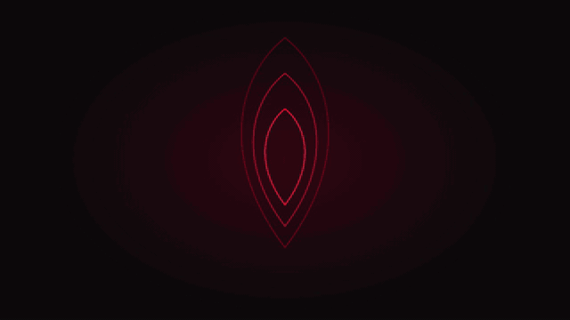
</p>

> (full quality: [1280×720 GIF](https://github.com/John-Butler3/Peeparr/releases/download/v1.0.0/peeparr-ad-hq.gif), [MP4](docs/assets/peeparr-ad.mp4)) video and screenshots use demo data

## Contents

- [How it fits together](#how-it-fits-together)
- [Features](#features)
- [On your phone](#on-your-phone)
- [What you need](#what-you-need)
- [Self-hosted quick start](#self-hosted-quick-start)
- [Updating, rollback and backups](#updating)
- [Local development](#local-development)

## How it fits together

| | Peeparr's part |
| --- | --- |
| **Stash** | Your library. Peeparr plays your scenes, shows what you have, and keeps up with what's new in it. |
| **StashDB, FansDB or ThePornDB** | The catalog, chosen at setup. Peeparr discovers scenes, performers and studios there. |
| **Whisparr (Eros)** | Downloads. Peeparr sends your requests there and follows each one into Stash. |

Every scene shows where it is in that journey: requested, downloading, importing, failed, or in your library and ready to play.

## Features

### Home

<p align="center">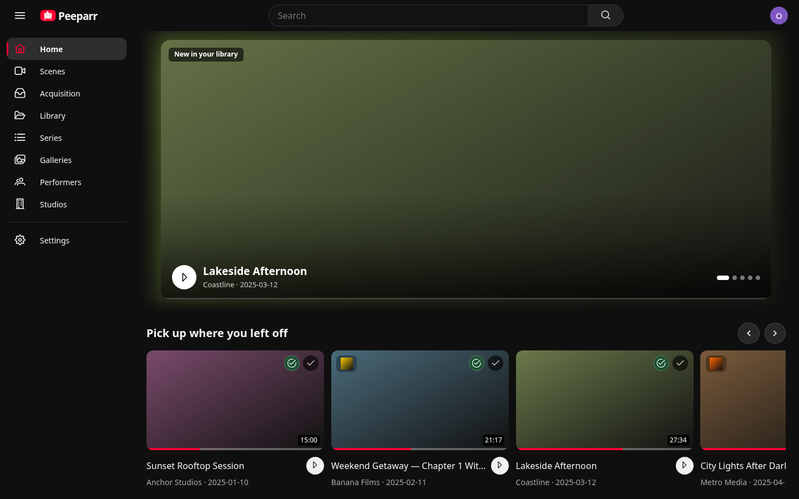</p>

- **A banner of the newest scenes in your library.** Each one plays its preview and moves on when the preview has played through. You can swipe between scenes, and a bar along the bottom shows when the next one is coming. On wide screens a soft glow of the preview spreads out behind the banner.
- **Pick up where you left off**, **Fresh in your library** and **Popular right now** rows. For ThePornDB, Popular is the site's own popular list, read with your saved website login and cached.
- **Search everything from one box:** performers, sites and scenes, a few of each with *Show more*.
- **Smooth page changes.** A thin red bar runs along the top while the next page loads. The page then appears complete, rising gently into place, rather than filling in piece by piece.

### Discover and request

<p align="center">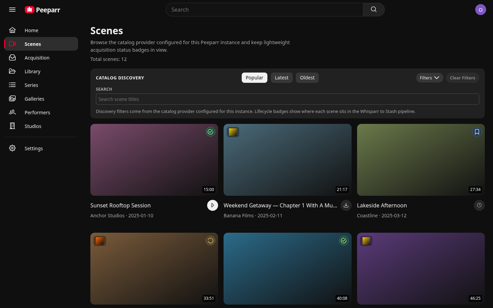</p>

- **Browse the catalog** by Popular, Latest or Oldest, and filter by tags, studios and favourites. You can also hide amateur and creator networks.
- **Request with one tap.** The button beside a scene's title becomes its status: requested, downloading, importing or failed.
- **Previews everywhere.** Hover a scene (or, on a phone, just stop scrolling) and its Stash preview plays. If a scene has no preview clip, it plays from the middle of the video instead.
- **Acquisition** shows every request on its way through the pipeline, with the ones that need you first.

<p align="center">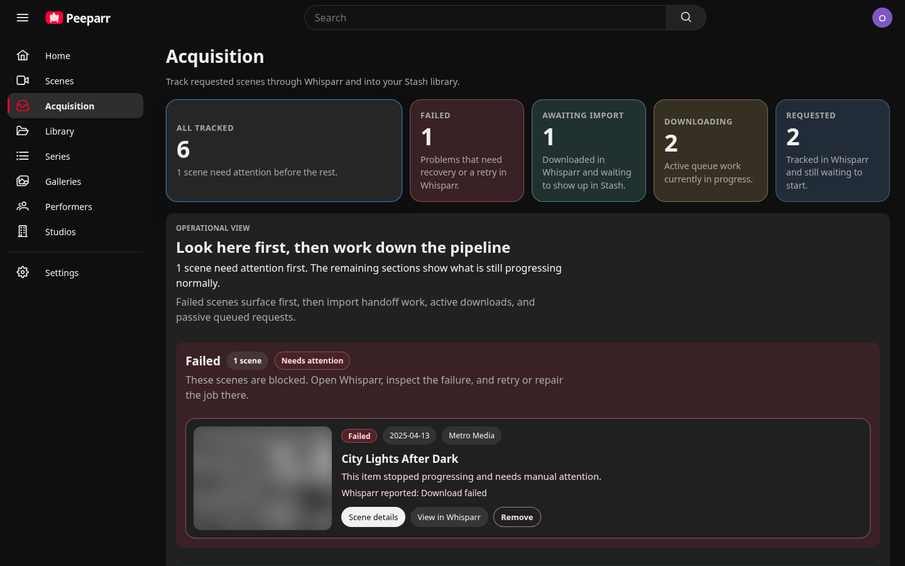</p>

### Watch

<p align="center">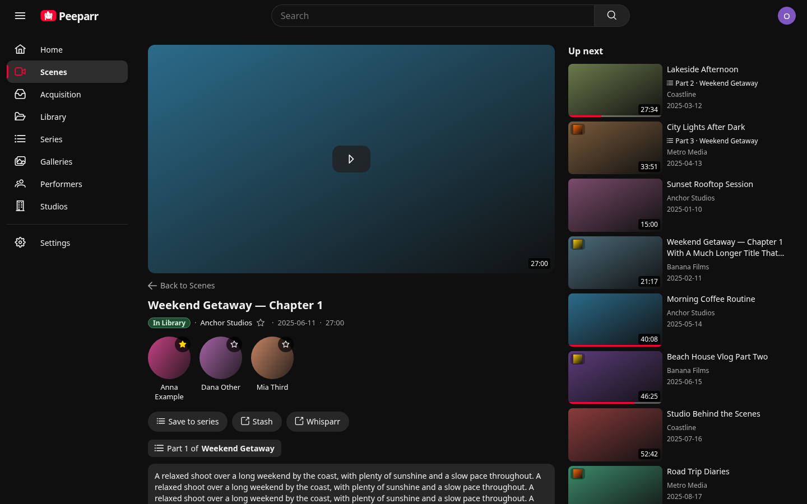</p>

- **Scene pages.** Under the title is one tidy line: the status, the site, the date and the length. Below it are the performers, then the description and tags. Up next sits alongside.
- **Picks up where you stopped**, and keeps your place across devices.
- **Up next** follows a series in order. It then offers related library scenes, including ones with the same performers, even on scenes you don't have yet.
- **Miniplayer.** Leave a playing scene and it carries on at the bottom of the screen. Tap it to go back to the scene, right where you were. On a phone, swipe the video down to send it there.
- **Lock screen and AirPlay** show the scene's title and picture, with playback controls.
- **Series:** group scenes into series, reorder their parts and play them in order. Peeparr uses Stash's own groups for this.

### Performers, studios and your library

<table>
  <tr>
    <td width="50%">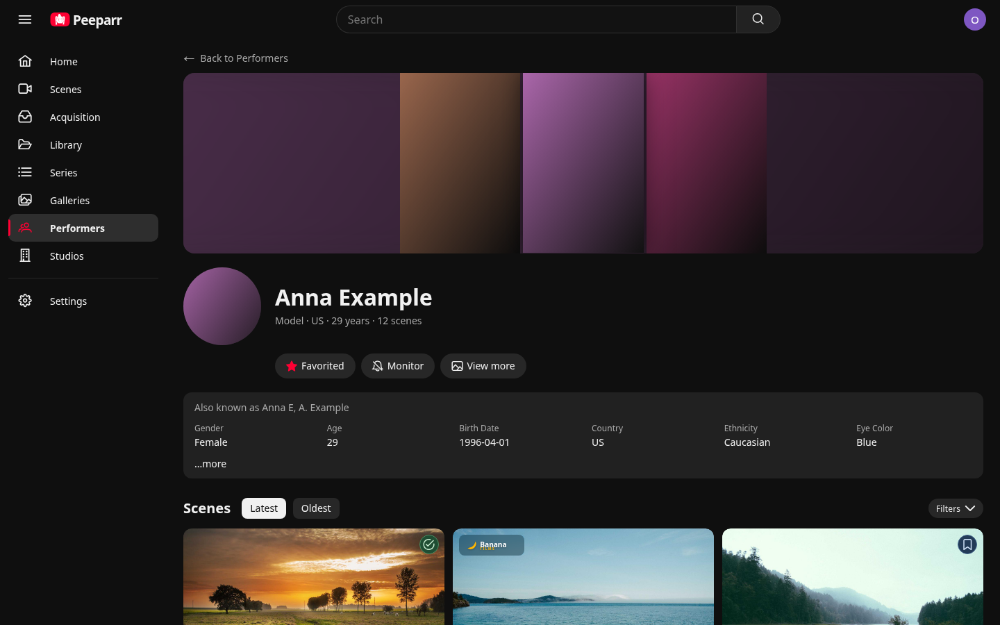</td>
    <td width="50%">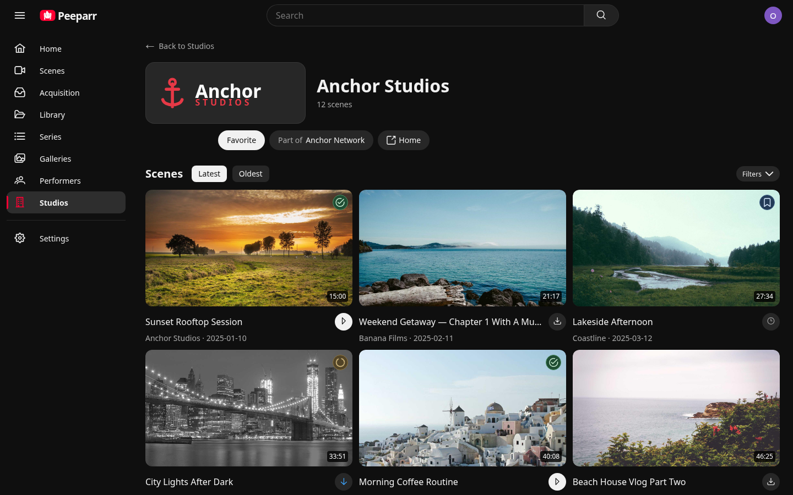</td>
  </tr>
</table>

- **Performer pages** open with a collage of the performer's photos. As you scroll, the name docks into a slim bar. You can favourite a performer, or **Monitor** them so their new scenes are requested automatically (past scenes never are).
- **Studio pages** show the studio's logo on a background that suits it, plus its parent network, child studios and website.
- **Library** browses your Stash library with filters, along with Galleries and Series.

<p align="center">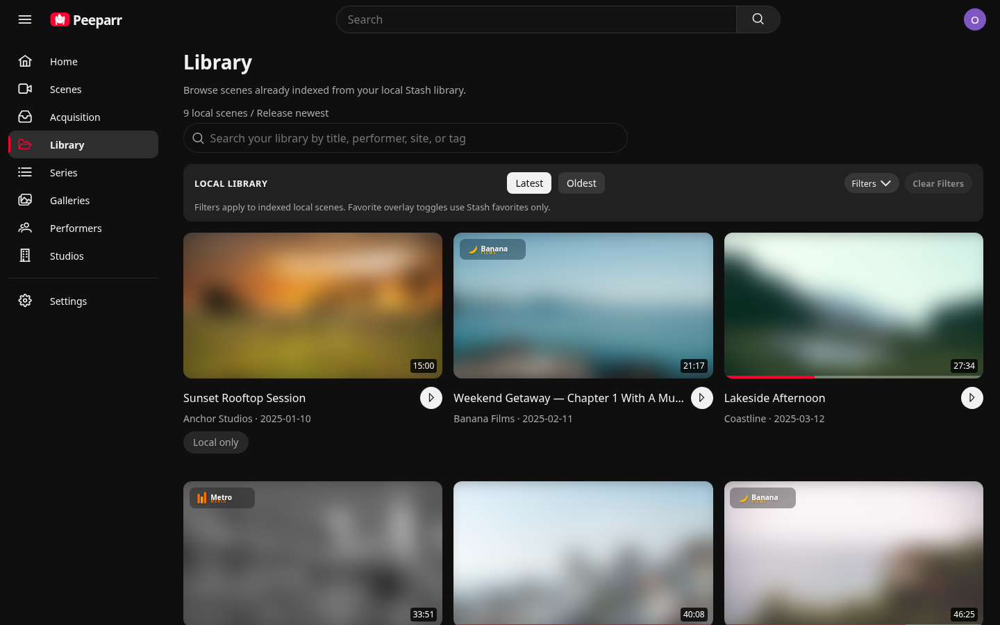</p>

### Setup and admin

- **Guided setup** for Stash, Whisparr and your catalog. Each connection is checked as you save it, and Settings shows when something needs repairing.
- **Discreet logo.** A per-device option in Settings › Content swaps the logo for a plain one, the red tile with an almond outline (). It applies in the top bar, on the sign-in page, at launch and on the browser tab.
- **One local admin account.** If you forget the password, a temporary one can be generated on the server.
- **ThePornDB, step by step.** Choose ThePornDB in setup and Peeparr explains what's needed:
  - where to get your API token;
  - the command that points Whisparr-Eros at Peeparr's ThePornDB metadata, with your Peeparr's address filled in and a Copy button;
  - the optional website login for ThePornDB's popular scenes.
  The same guide is in Settings › Integrations.

## On your phone

Peeparr is built for phones as much as desktops:

- a floating, Liquid Glass-style navigation bar, with a capsule that slides to the page you're on;
- scrolling that autoplays previews;
- swipe gestures;
- a picture that docks beside the title as you scroll.

Add it to your home screen and it opens like an app.

<table>
  <tr>
    <td width="25%">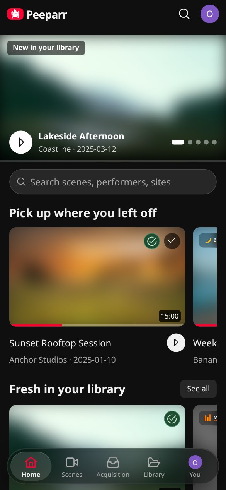</td>
    <td width="25%">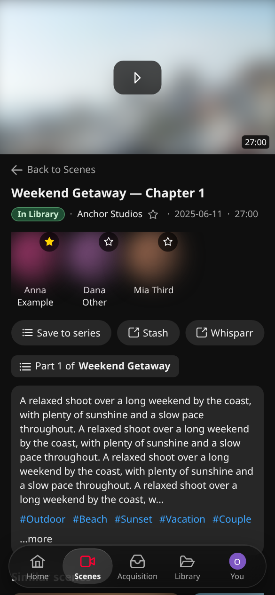</td>
    <td width="25%">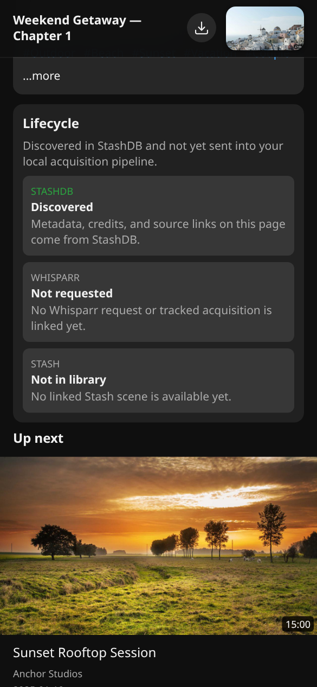</td>
    <td width="25%">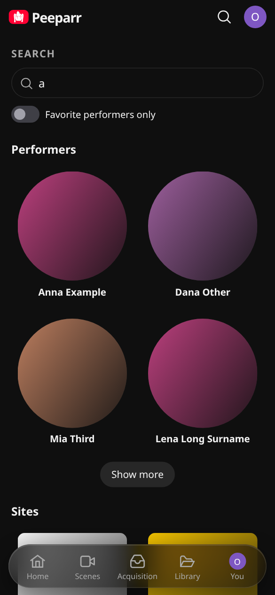</td>
  </tr>
</table>

## What you need

- A Linux machine (or Proxmox LXC) with Docker, or a Debian/Ubuntu machine the installer can put Docker on
- An existing Stash instance that Peeparr can reach
- An existing Whisparr (Eros) instance that Peeparr can reach
- A catalog to configure during setup: StashDB, FansDB or ThePornDB

## Self-hosted quick start

Peeparr is built from source on the machine it runs on. On a Debian/Ubuntu machine, as root:

```bash
curl -fsSL https://raw.githubusercontent.com/John-Butler3/Peeparr/main/scripts/install.sh | bash
```

The installer:

- installs Docker if needed;
- builds the app;
- writes `/opt/peeparr/compose.yaml` and a private `/opt/peeparr/.env` with a random database password;
- starts everything and prints the address.

On Proxmox, use the [Proxmox VE Helper-Scripts](https://community-scripts.github.io/ProxmoxVE/)-style installer instead. Run this in the Proxmox shell for a native (no Docker) LXC:

```bash
bash -c "$(curl -fsSL https://raw.githubusercontent.com/John-Butler3/Peeparr/main/infrastructure/proxmox/community-scripts/ct/peeparr.sh)"
```

Open `http://<host>:3000`. On the first visit you create the single local admin account; after that, signing in is required.

**Using ThePornDB as the catalog?** Whisparr-Eros must then use Peeparr's ThePornDB metadata proxy instead of its built-in StashDB metadata. Setup shows you how, with the command ready to copy. On the Whisparr-Eros machine:

```bash
curl -fsSLO https://raw.githubusercontent.com/John-Butler3/Peeparr/main/scripts/configure-eros.sh
bash configure-eros.sh --catalog tpdb --peeparr-url http://<host>:3000
```

With StashDB, a stock Eros works as-is.

See **[docs/DEPLOYMENT.md](docs/DEPLOYMENT.md)** for all the options: Proxmox, updating, backups, password reset and the full Whisparr-Eros explanation.

If the catalog's Save & Test keeps failing with `ETIMEDOUT` on an IPv4-only Docker network, uncomment `NODE_OPTIONS=--no-network-family-autoselection` in `/opt/peeparr/.env` and run `peeparr-update`.

## Updating

```bash
peeparr-update
```

This rebuilds from the latest commits of the deployed branch and restarts. Peeparr applies database migrations automatically when the app container starts.

## Rollback

Deploy an earlier branch or commit from the source checkout (`/opt/peeparr-src`), for example `peeparr-update -b <branch>`.

Rolling back the app does not roll back database schema changes. Take a backup before updating, and restore it if an older build can't start against the migrated schema.

## Backups

Keep:

- `/opt/peeparr/.env` and `/opt/peeparr/compose.yaml`;
- the Docker volumes `peeparr_postgres_data` and `peeparr_app_data` (the second holds the generated session secret).

To take a database dump:

```bash
cd /opt/peeparr
docker compose exec -T postgres sh -c 'pg_dump -U "$POSTGRES_USER" "$POSTGRES_DB"' > peeparr-backup.sql
```

## Local development

To run the repo locally for development:

1. Install dependencies with `pnpm install`.
2. Copy `.env.example` to `.env` and set `SESSION_SECRET`.
3. Start Postgres with `pnpm run dev:db`.
4. Run the backend with `pnpm run backend`.
5. Run the frontend with `pnpm run web`.

The app is an Angular front end and a NestJS back end, with Postgres through Prisma.

If an older local database says migration `20260402142846` was modified after it was applied, run `pnpm run db:repair-runtime-health-migration` once, then rerun `pnpm prisma migrate dev`.

## Contributing

For the repo's structure, release automation, CI expectations, PR conventions and deployment notes for contributors, see [CONTRIBUTING.md](CONTRIBUTING.md).

## License

[GPL-3.0](LICENSE)
